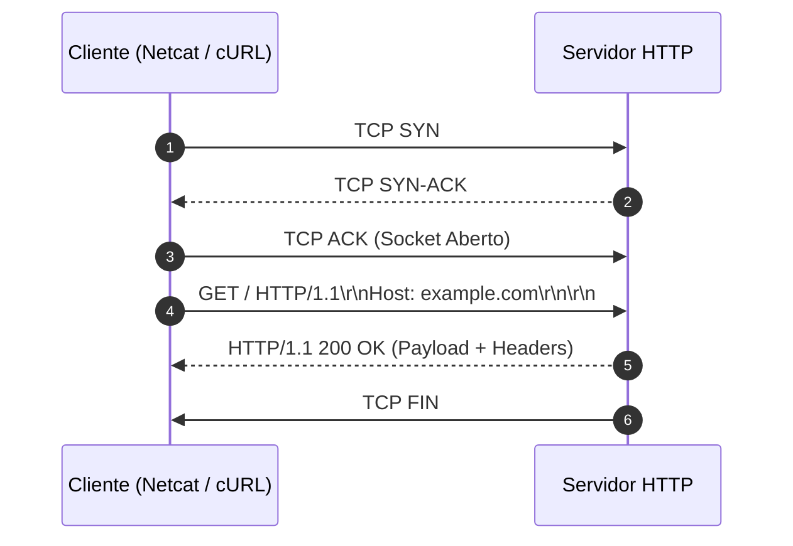

# Memória de Desenvolvimento — Semana 01: Protocolo HTTP & Sockets Bare-Metal

**Aluno:** José Ribeiro da Costa Neto  
**Matrícula:** 202311200310  
**Curso:** BSI

---

## 1. Mapeamento da Camada de Transporte
Diagrama Mermaid demonstrando o ciclo de vida da requisição executada no laboratório:

---

## 2. Registro dos Experimentos de Laboratório

### Experimento 1: Netcat Nu & Falha 400 Bad Request
* **Comando Testado:** `nc -C example.com 80` sem o header `Host:`
* **Resultado:** Retorna Bad request pois sem a informação do Host a requisição não é direcionada ao servidor correto

### Experimento 2: Semântica dos Métodos HTTP
* **Análise dos Verbos:** Explique a diferença observada entre chamadas `GET`, `POST` e `OPTIONS`.
* **Header Content-Length:** Como o tamanho do payload afeta a leitura no buffer do socket?
*  O tamanho do payload afeta diretamente a eficiência, a latência e a complexidade do código ao ler dados do buffer de um socket

### Experimento 3: URL, Query Strings & Percent-Encoding
* **URL Testada: (Passo 1)** curl -v http://httpbin.org/get?curso=Engenharia da Computacao
* **URL Testada: (Passo 2)** curl -v https://httpbin.org/get?curso=Engenharia%20da%20Computa%C3%A7%C3%A3o
* **O erro no Passo 1:** O que o terminal retornou ao tentar rodar a URL com espaços reais?
  O terminal não interpretou corretamente o comando, não soube onde o comando acabava, resultando em uma requisição incompleta
* **A função do `%20`:** Explique de forma simples por que somos obrigados a substituir espaços e caracteres especiais (como acentos) por códigos com `%` nas URLs.
  Para evitar conflitos entre caracteres usados em comandos no terminal e evitar espaços em branco e caracteres especiais nas URL's é necessarios substitui-las com o auxilio do percent encoding

### Experimento 4: Negociação de Conteúdo & User-Agent
* **Análise:** Como o servidor reage ao receber diferentes cabeçalhos `Accept` e `User-Agent`?
  São informações uteis na requisição como a informação de qual tipo de arquivo o client consegue receber(Accept) e qual o software que está realizando a requisição(User-Agent)
  

### Experimento 5: Redirecionamentos & Cache Condicional
* **Redirecionamento (301):** Qual a diferença ao executar `curl -I` com e sem a flag `-L`?
  A flag -L segue os redirecionamentos da pagina até encontrar o final e o -I impede o redirecionamento automatico
* **Validação de Cache (304):** Explique como o header `If-None-Match` e a `ETag` evitam retransmissão de dados na rede.
  A ETag identifica uma versão de um recurso armazenado em cache. O cliente envia essa identificação no cabeçalho If-None-Match para verificar se o conteúdo foi alterado. Se não houver alterações, o servidor responde com 304 Not Modified, evitando retransmitir o conteúdo e reduzindo o tráfego de rede.

---

## 3. Conclusão Técnica
Compreender a transmissão de bytes ASCII e a sintaxe CRLF (Carriage Return Line Feed, representada por \r\n) na camada de aplicação é fundamental para entender como protocolos como HTTP estruturam e transmitem mensagens entre clientes e servidores. O uso correto desses caracteres permite delimitar linhas de requisição, cabeçalhos e o início do corpo da mensagem, garantindo que os dados sejam interpretados corretamente pelos sistemas envolvidos. Erros na formatação dessas mensagens podem provocar falhas de comunicação, respostas inválidas e dificuldades na interoperabilidade entre diferentes plataformas.

No desenvolvimento de sistemas distribuídos e de alta performance, esse conhecimento também contribui para otimizar a comunicação pela rede, reduzir o processamento desnecessário e facilitar a identificação de problemas em requisições e respostas. Ao compreender como os dados são representados e transmitidos em bytes, o desenvolvedor consegue implementar mecanismos eficientes de leitura e análise de protocolos, melhorar o uso de recursos computacionais e desenvolver aplicações mais robustas, escaláveis e confiávei**
